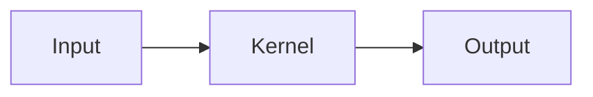

# MiyaaL.github.io

MiyaaL 的个人主页与技术博客，使用 GitHub Pages 原生支持的 Jekyll 构建。内容、排版与提交约定见 [AGENTS.md](AGENTS.md)。

站点地址：<https://miyaal.github.io>

## 功能

- 英文界面、中文文章；主题默认跟随系统，可手动切换浅色、深色
- 首页自动展示最近 6 篇文章
- Blog 归档支持标签筛选与本地关键词搜索，课程笔记按系列聚合
- Plan 是交互式力量训练计划：周期进度图、训练日历、训练记录与 ICS 导出
- Markdown 与 HTML 文章、Rouge 代码高亮和一键复制
- 按文章启用 LaTeX 公式与 Mermaid 图表
- RSS、Sitemap、SEO 元数据和响应式布局
- 站点静态部署；Plan 的可选同步后端使用 Supabase Auth、Postgres 与 RLS

## 本地预览

本机只需安装 Docker：

```bash
docker compose up
```

首次运行会下载 Ruby 镜像并安装依赖。构建完成后访问
<http://localhost:4000>，修改文件会自动刷新。

如需同时预览 `_drafts/` 中的草稿，先至少运行一次上面的命令安装依赖，
然后使用：

```bash
docker compose run --rm --service-ports site \
  bundle exec jekyll serve --host 0.0.0.0 --livereload --force_polling --drafts
```

## 写一篇新文章

已发布文章按专题放在 `_posts/` 的子目录中，文件名必须使用：

```text
_posts/<专题目录>/YYYY-MM-DD-英文短名.md
_posts/<专题目录>/YYYY-MM-DD-英文短名.html
```

当前目录约定是 `courses/<课程名>/`、`essays/`、`derivations/`、
`chip-architecture/` 和 `technical-analysis/`。没有内容的目录不需要提前创建。

Markdown 文章可以从 `_drafts/template.md` 复制；HTML 技术报告可以从
`_drafts/technical-analysis/report-template.html` 复制。两种格式使用相同的文章头部：

```yaml
---
title: "文章标题"
date: 2026-07-30 12:00:00 +0800
description: "用一句话说明文章解决的问题。"
tags: [CUDA, 性能优化]
math: false
mermaid: false
---
```

其中 `title`、`date`、`description`、`tags` 是常用字段。只有文章包含公式时才将
`math` 改为 `true`，只有包含 Mermaid 图表时才将 `mermaid` 改为 `true`。

### 草稿

草稿按专题放入 `_drafts/`，发布时再移动到对应的
`_posts/<专题目录>/YYYY-MM-DD-英文短名.md` 或 `.html`。这是 Jekyll 的原生草稿机制，
可以保证 GitHub Pages 不会生成草稿详情页。

### HTML 技术报告

HTML 报告是带 YAML Front Matter 的正文片段，继续使用站点统一的文章布局；不要写完整的
`<!doctype html>`、`<html>`、`<head>` 或 `<body>` 外壳。正文使用语义化 HTML：

```html
<section>
  <h2>测试方法</h2>
  <p>说明环境、基线与测量协议。</p>
  <pre><code class="language-python">print("result")</code></pre>
</section>
```

文章标题只写在 Front Matter 中，正文从 `<h2>` 开始。左侧目录会自动读取
`<h2>`–`<h4>`；HTML 图片必须同时提供 `src="/assets/posts/..."` 和有意义的 `alt`。
HTML 源文件不会解析 Markdown 语法。

### LaTeX 公式

先在文章元数据中设置 `math: true`，然后使用：

```markdown
行内公式：$E = mc^2$

$$
\operatorname{softmax}(x_i) = \frac{e^{x_i}}{\sum_j e^{x_j}}
$$
```

### Mermaid 图表

先设置 `mermaid: true`。Markdown 使用 Mermaid 代码块：

````markdown

````

HTML 使用 `<pre><code class="language-mermaid">...</code></pre>`。

### 图片

文章图片统一放入 `assets/posts/<文章短名>/`：

```markdown

```

图片使用 WebP，宽度不超过 1600px，并始终填写有意义的图片说明。

## 检查与测试

提交前运行文章格式检查和生产式构建：

```bash
docker compose run --rm site bundle exec ruby scripts/check_blog_format.rb
docker compose run --rm site bundle exec jekyll build --trace
```

Plan 的单元测试与 DOM 测试使用 Node.js 22 自带的测试运行器：

```bash
npm ci
npm test
```

同样的检查由 `.github/workflows/ci.yml` 在每次 push 和 pull request 时执行。

## 发布

站点由 GitHub Pages 从 `main` 分支根目录构建（仓库 **Settings → Pages → Deploy from a branch**）。
推送到 `main` 即发布：

```bash
git add _posts assets/posts
git commit -m "post: add article title"
git push
```

## 主要目录

```text
.
├── .github/workflows/ # CI：格式检查、Jekyll 构建、Plan 测试
├── _drafts/           # 按专题组织的 Markdown/HTML 草稿与模板
├── _includes/         # 可复用页面片段
├── _layouts/          # 页面和文章模板
├── _posts/            # 按专题组织的已发布 Markdown/HTML 文章
│   ├── courses/
│   │   ├── cs224n/
│   │   └── cs336/
│   └── derivations/
├── assets/
│   ├── css/           # 站点、课程、文章目录与 Plan 样式
│   ├── data/          # Plan 使用的节假日数据
│   ├── icons/         # 图标与分享卡片
│   ├── js/            # 主题、搜索、代码复制、目录、Mermaid 与 Plan
│   └── posts/         # 文章图片
├── blog/              # Blog 归档页
├── courses/           # 课程系列索引页
├── docs/plan/         # 训练方案评审记录
├── plan/              # 交互式训练计划
├── scripts/           # 文章格式与排版合约检查
├── supabase/          # Plan 同步的数据库迁移与配置说明
├── tests/             # Plan 的单元测试与 DOM 测试
├── AGENTS.md          # 内容、排版与提交约定
├── _config.yml        # 站点配置
└── index.html         # 首页
```

## 许可

站点源代码与主题使用 [MIT License](LICENSE)。`_posts/`、`_drafts/` 和
`assets/posts/` 中的原创文章与媒体内容保留全部权利，详见
[CONTENT-LICENSE.md](CONTENT-LICENSE.md)。
