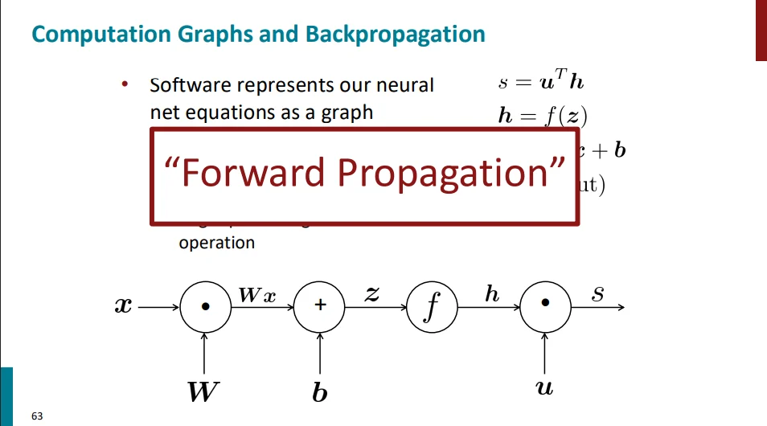
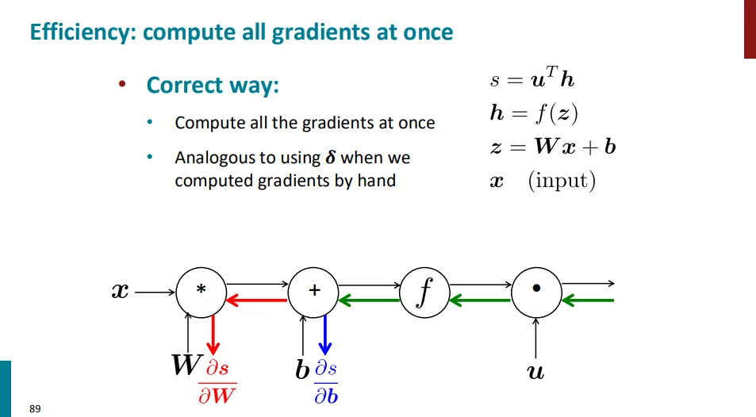
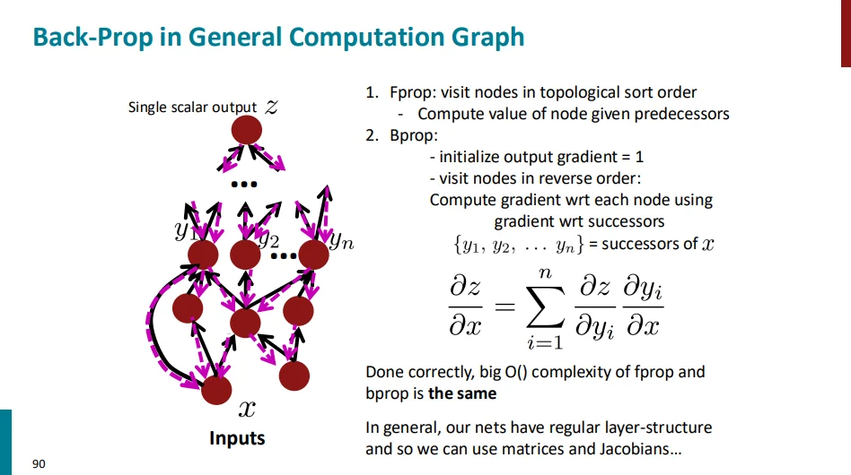
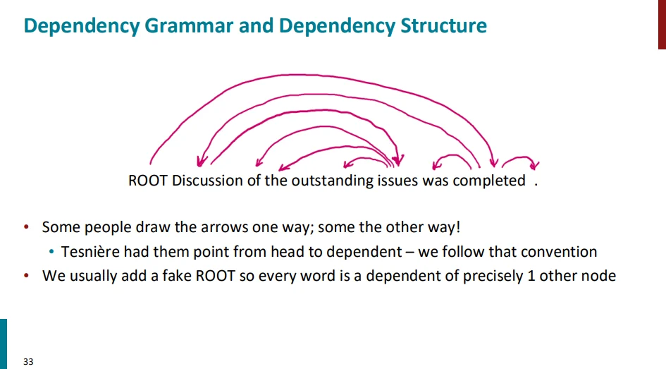

> 本文是 [Stanford CS224N（Spring 2025）](https://web.stanford.edu/class/archive/cs/cs224n/cs224n.1254/)的个人学习笔记，并非课程官方材料。课程截图及相关材料版权归 Stanford University 与课程作者所有。

## 一、梯度计算

这一节简单介绍了链式求导法则，及矩阵求偏导的规则。较为简单这里不赘述。

## 二、反向传播

正向传播对应着神经网络正常计算loss的方向，而反向传播对应的loss反馈到权重按照梯度进行训练的方向。

- Forward Propagation

- Backward Propagation

二者在计算图中的方向如下图所示：

## 三、句子语言结构

### 3.1 两种观点

- 短语结构语法（phrase structure grammar）：认为每个句子由各种短语组合、嵌套而成。这也是一种上下文无关语法（context-free grammars (CFGs)）。如果句子内全部由上下文无关的短语构成，那么句子的含义可能会充满歧义与谬误，而上下文依赖关系及路径可以帮我们更好的认知句子语意。
- **依存结构（Dependency Structure）**：认为每个句子内的单词都是依赖于其他单词的。假设句法结构由词项之间的关系构成，这些关系通常是二元非对称关系，称为依存关系。

上世纪90年代初以Penn Treebank为代表，兴起了人工标注句法树库（treebank）的浪潮。而依存句法的直接信息来源有哪些呢？

1. 词义相似性：依存关系[讨论→问题]是合理的
2. 依存距离：大多数依存关系存在于相邻词之间
3. 插入语：依存关系很少跨越插入的动词或标点符号
4. 中心词的配价：一个中心词通常在其哪一侧有多少个依存关系？

### 3.2 依存语法解析

一般来讲句子的依存语法解析有如下限制：

- 只有一个单词依赖于ROOT根节点
- 没有循环结构，例如A->B，B->A
- （可选）如果把依存关系画成词与词之间的弧线（通常画在句子上方），这些弧线是否可以交叉：
  - 不交叉：投射解析（projective parse）
