> 本文是 [Stanford CS224N（Spring 2025）](https://web.stanford.edu/class/archive/cs/cs224n/cs224n.1254/)的个人学习笔记，并非课程官方材料。课程截图及相关材料版权归 Stanford University 与课程作者所有。

## 1 pretraining

### 1.1 核心观点

- 让模型可以训练更大尺度、更多样的数据集
- 不使用标注数据集，否则无法进行scaling
- 计算感知scaling

### 1.2 子词建模

大意就是训练时可以采用**Byte-pair encoding**的方式来进行子词建模，主要分为如下几个步骤：

- 从只包含字符和词尾结束符的词表开始训练
- 使用文本语料，找到最经常连接在一起的字符，并组成一个子词(**subword**)，例如"a"和"b"组成"ab"
- 不断替换字符对为新的子词，直到获得我们想要的词表大小

上述办法最一开始用于机器翻译，现在发展出的一种相似方法（WordPiece）被广泛用于预训练中。

### 1.3 pretrained word embeddings

这是之前的预训练方式，仅对词嵌入进行预训练，这时的预训练不获取词与词之间的上下文关系，仅仅只是对embedding做预训练，其他部分的权重都是随机初始化的。

### 1.4 pretraining whole models

这是现在的预训练方式，对几乎整个模型进行预训练，大部分权重在正式训练之前的权重都不是随机初始化的。优点主要是：

- 加速训练过程：训练的初始参数不再是随机初始化的
- 提高性能：学习通用特征
- 解决数据不足问题：因为不需要标签数据，可以引入大规模数据集
- 迁移学习：预训练的大规模数据集通用特征提取较好，可以拿预训练的数据对新的场景或者任务再做训练，迁移能力较强
- 提高泛化能力：大规模数据集提取的通用特征，有助于避免模型在训练集上的过拟合

> 试想一下，从大规模数据集预训练得到的参数，本就可能是一个较优的权重$\hat{\theta}$，这时再用$\hat{\theta}$来通过任一种（例如SGD）优化器进行训练，寻找到的局部极小值可能也具备$\hat{\theta}$的一些特性，例如泛化性等等。

### 1.5 预训练方法

主要是有3种预训练类型：

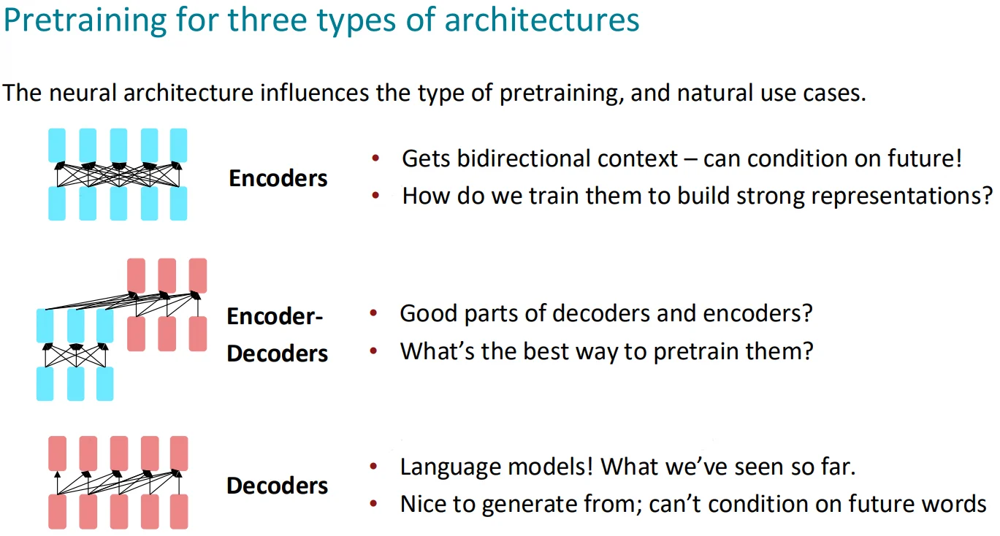

#### 1.5.1 Pretraining encoders

encoder可以看到完整的上下文信息，因此不能单独拿来做自回归生成式语言模型，但可以用来做masked LM，也就是“完形填空”。比较经典的就是BERT(Bidirectional Encoder Representations from Transformers) Masked LM。BERT的预训练成本非常高昂，但是微调的成本却比较低。这可以让BERT一次预训练，在不同的任务中多次微调。也有很多BERT微调的扩展模型，例如：RoBERTa、SpanBERT等等。

#### 1.5.2 Pretraining encoder-decoders

encoder主要用于从双向上下文获取信息，decoder主要负责实现语言模型的功能。T5(Text-To-Text Transfer Transformer)模型就是一种encoder-decoders预训练模型，他的创新之处在于将各种NLP任务统一表示为文本到文本任务：

- 对于分类任务，输入的是文本，输出是类别的文本表示。
- 对于翻译任务，输入是源语言的文本，输出是目标语言的文本。
- 对于问答任务，输入是问题和上下文，输出是答案文本。

T5模型采用一种叫**Span Corruption**(填空任务)的任务来进行预训练，并采用**encoder-decoders transformer**结构来做预训练，论文数据证明这样效果比**language modeling**、**decoder transformer**更加好。

#### 1.5.3 Pretraining decoders

decoder可以用**language modeling**来做训练，代表性的就是**GPT**(Generative Pretrained Transformer)，这种大型预训练模型似乎并不需要进行梯度更新就可以从输入语料中学习到部分规律，例如可以输入部分规则，让模型根据规则来进行回答等等。

### 1.6 scaling laws

- scaling有助于降低模型困惑度
- scaling有助于识别模型规模与数据之间的trade-off
- scaling可以帮助我们做出模型架构的取舍

一般来说，模型的规模(parameters)与训练所需的数据量(tokens)应该同步增长。按Chinchilla的结论，token数大约应是参数量的20倍：Chinchilla本身是70 Billion参数，使用了1.4 Trillion tokens来做训练。

## 2 post-training

### 2.1 finetuning

为什么需要**finetuning**，其实是因为经海量数据预训练后的模型无法满足user的多种任务需求。finetuning和pretraining都可以采用问答方式来进行训练。

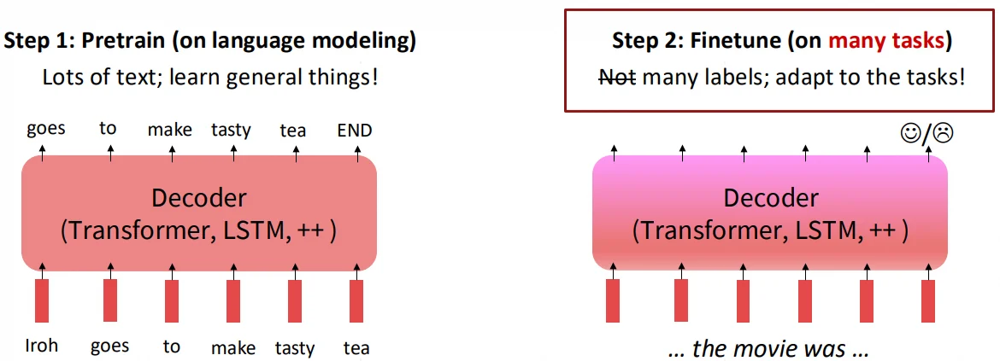

#### 2.1.1 multi-task benchmark

现在也有很多大型benchmark，例如MMLU(Massive Multitask Language Understanding)、BIG-Bench等等，可以用来评估模型微调的能力。他们都包含多种不同类型的任务，可以从不同方面对模型做有效评估。

#### 2.1.2 Instruction finetuning

**指令微调**：在带有指令提示和相应输出的标记数据集上微调大模型的技术，通过提供一组概述所需操作的指南或指令，使预训练模型适应执行特定任务。

例如：

- 指令：“你是一个乐于助人、尊重他人且诚实的助手。始终尽可能有帮助地回答，同时确保安全。你的回答不应包含任何有害、不道德、种族主义、性别歧视、恶毒、危险或非法的内容。请确保你的回答在社会上不带有偏见，并且具有积极的性质。如果一个问题没有意义，或事实不连贯，请解释原因，而不是回答错误的内容。如果你不知道问题的答案，请不要分享错误信息。”
- 上下文：<<输入你的上下文>>
- 问题：<<输入你的问题>>
- 输出：<<针对问题的示例输出>>

指令微调之前模型可能无法正确回答问题：

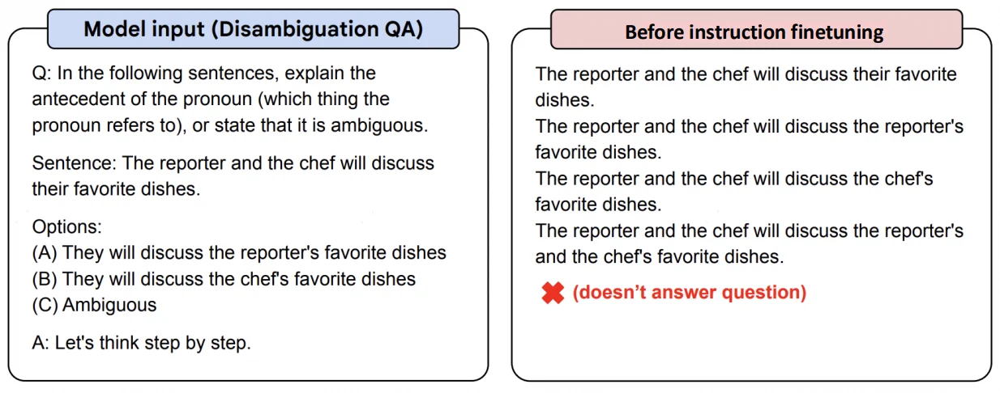

微调之后，可以正确回答：

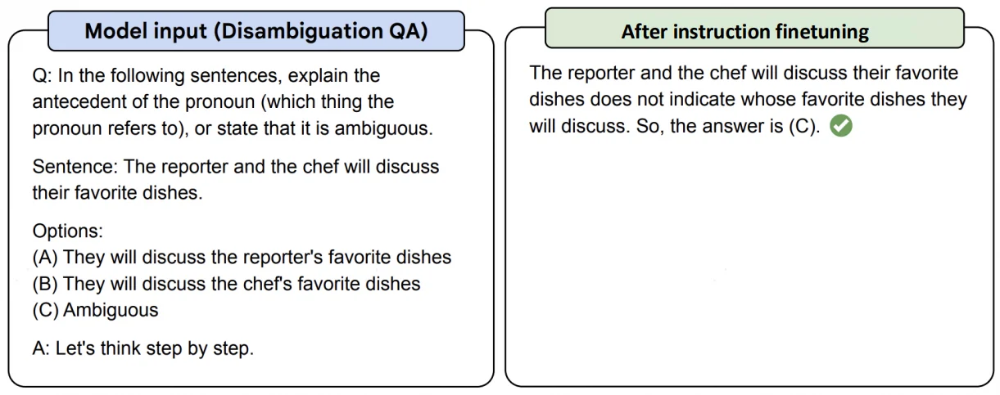

### 2.2 Reinforcement Learning from Human Feedback (RLHF)

#### 2.2.1 场景

指令微调后，部分任务可能仍然无法满足用户需求，例如有些问题的答案可能本身就是开放性的，没有正确之分。为了满足用户喜好，这时就需要RLHF：

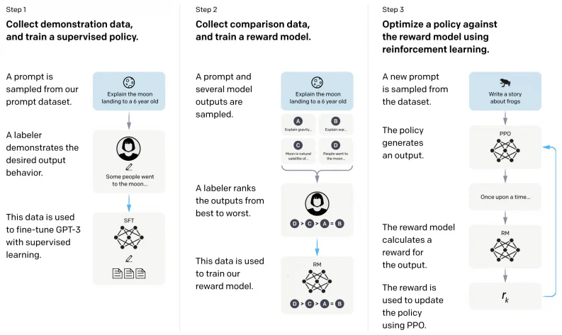

#### 2.2.2 强化学习简单原理

这里非常简要的过了一下强化学习的原理，假设对模型的每个回答$s$都能拿到一个人类给出的奖励$R(s)$，奖励越大越好。那么我们期望最终达成的目标就是最大化LLM回答的Reward：

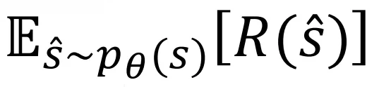

那么参数更新的方式可以以梯度上升为例：

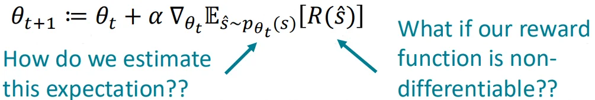

其中梯度可以挪到期望的内部：

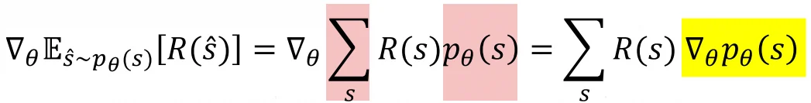

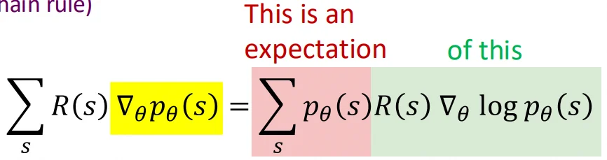

最终经过蒙特卡洛采样期望可以约等于离散数据的采样：

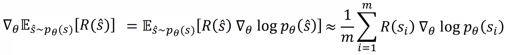

那么$\theta$的更新方式就变为了：

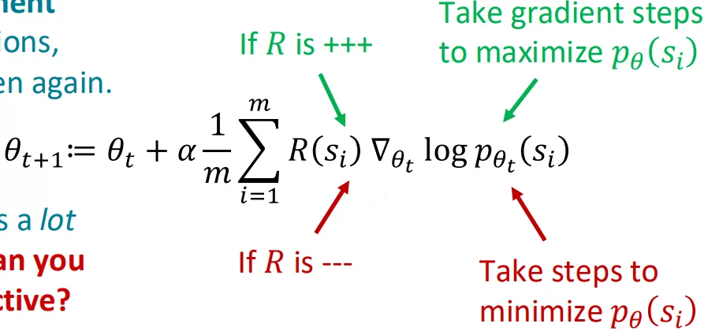

这样就不需要对$R(s)$求导了，$R(s)$可以是任意不可导的黑盒函数，只需要对$\log p_\theta(s)$求导。

#### 2.2.3 训练方式

上述方式带来了几个问题：

- 人工标注成本较高：可以单独训练一个模型$RM_{\phi}(s)$来做这件事情
- 人工标注可能存在很多噪声和校准错误：不直接问评分多少，而是从几个评分中进行比较选择。

最终RLHF的训练方式如下：

- 获取预训练模型$p^{PT}(s)$，通过大量数据集训练得到，泛化性较好但特化性不足
- 获取奖励模型$RM_{\phi}(s)$，通过人类评分比较数据集训练得到
- 用$p^{PT}$的参数初始化待训练的模型$p_{\theta}^{RL}(s)$
- 开始训练并通过如下方式进行更新：

$$
R(s)
  = RM_{\phi}(s)
    - \beta \log\!\left(
        \frac{p_{\theta}^{\mathrm{RL}}(s)}{p^{\mathrm{PT}}(s)}
      \right)
  \label{2.1} \tag{2.1}
$$

其中第二项是下面这个对数概率比，它在$s \sim p_{\theta}^{RL}$下的期望就是$\mathrm{KL}(p_{\theta}^{RL} \,\Vert\, p^{PT})$，作为防止RLHF训练后的模型偏离预训练模型过多而添加的惩罚项。

$$
\log\!\left(
  \frac{p_{\theta}^{\mathrm{RL}}(s)}{p^{\mathrm{PT}}(s)}
\right)
\label{2.2} \tag{2.2}
$$

可以看出，当$p_{\theta}^{RL}(s)$和$p^{PT}(s)$越是接近，或者完全一致时，惩罚项的期望将越趋近于0。

### 2.3 RL + Reward Modeling 限制

- 用户偏好以及基于用户偏好训出的RM是不可靠的：有时模型会为了提供看起来权威或者有帮助的回答，与事实真相相去甚远，产生幻觉。这是一种所谓的"Reward Hacking"(奖励黑客)，指RL中模型利用奖励函数的一些歧义或者捷径来获得高奖励但并未真正对任务和数据集进行学习。

### 2.4 Direct Preference Optimization(DPO)

DPO的idea主要是想绕过奖励模型RM，直接从偏好数据获取优化策略，主要基于以下理论推导：

1. 假设初始情况下我们follow RLHF的期望最大化原则：

$$
\mathbb{E}_{\hat{y} \sim p_{\theta}^{\mathrm{RL}}(\hat{y} \mid x)}
\left[
  RM_{\phi}(x,\hat{y})
  - \beta \log\!\left(
      \frac{p_{\theta}^{\mathrm{RL}}(\hat{y} \mid x)}
           {p^{\mathrm{PT}}(\hat{y} \mid x)}
    \right)
\right]
\label{2.3} \tag{2.3}
$$

2. 而在Bradley-Terry模型下，我们认为人类偏好可以由下述loss来描述：

$$
J_{\mathrm{DPO}}(\theta)
  = -\mathbb{E}_{(x,y_w,y_l)\sim D}
    \left[
      \log \sigma\!\left(
        RM_{\theta}(x,y_w)-RM_{\theta}(x,y_l)
      \right)
    \right]
  \label{2.4} \tag{2.4}
$$

其中，$y_w$表示被偏好的回答（"win"），$y_l$表示不被偏好的回答（"lose"）。奖励的绝对值和正负没有意义，起作用的只有两者之差：差越大，$y_w$胜出的概率越高。

3. 式 $\eqref{2.3}$ 的最优策略有闭式解，反过来可以把奖励函数用策略表示出来，其中$Z(x)$是只与$x$有关的归一化项：

$$
RM_{\theta}(x,\hat{y})
  = \beta \log\!\left(
      \frac{p_{\theta}^{\mathrm{RL}}(\hat{y} \mid x)}
           {p^{\mathrm{PT}}(\hat{y} \mid x)}
    \right)
    + Z(x)
  \label{2.5} \tag{2.5}
$$

4. 那么Bradley-Terry模型下，loss最终可以描述为下述形式：

$$
\begin{aligned}
J_{\mathrm{DPO}}(\theta)
  = -\mathbb{E}_{(x,y_w,y_l)\sim D}
    \Bigg[
      \log \sigma\!\Bigg(
        &\beta \log
          \frac{p_{\theta}^{\mathrm{RL}}(y_w \mid x)}
               {p^{\mathrm{PT}}(y_w \mid x)} \\
        &- \beta \log
          \frac{p_{\theta}^{\mathrm{RL}}(y_l \mid x)}
               {p^{\mathrm{PT}}(y_l \mid x)}
      \Bigg)
    \Bigg]
\end{aligned}
\label{2.6} \tag{2.6}
$$

    - 可以看到，$Z(x)$与$y_w$和$y_l$均无关，而Bradley-Terry模型只依赖两个奖励之差，所以$Z(x)$在做差时直接消掉了，不需要计算。
    - 式 $\eqref{2.6}$ 说明loss的计算完全不依赖于单独的Reward模型，而仅与策略$p_\theta^{RL}$和$p^{PT}$有关：相对于预训练模型，提高$y_w$的概率、降低$y_l$的概率，loss就会下降。

下图展示了RLHF和DPO的流程区别。DPO流程简单，在开源模型的对齐中使用很广泛。

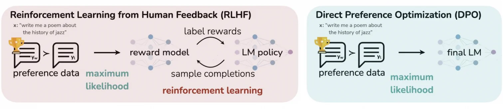

### 2.5 人类偏好数据来源

- 外包的人工标注
- 用模型给出反馈（AI feedback）

### 2.6 总结

| 维度 | Prompting | Instruction Tuning | RLHF | DPO |
| --- | --- | --- | --- | --- |
| 是否更新模型参数 | 否 | 是 | 是 | 是 |
| 所需数据 | 无（只需设计prompt） | 指令-回答对 | 偏好对（A优于B） | 偏好对（同RLHF） |
| 训练流程 | 无 | 有监督微调 | 先训练奖励模型，再用RL（如PPO）优化策略 | 直接在偏好数据上做有监督训练 |
| 主要优点 | 迭代快，不需要训练 | 简单稳定，提升指令遵循能力 | 可以直接优化人类偏好 | 不需要奖励模型和RL，流程简单 |
| 主要缺点 | 效果依赖prompt写法 | 只能模仿示例，无法直接优化偏好 | 流程复杂，训练不稳定，开销大 | 依赖Bradley-Terry偏好模型的假设和偏好数据的质量 |
