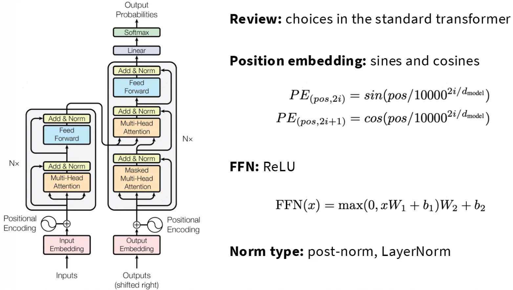
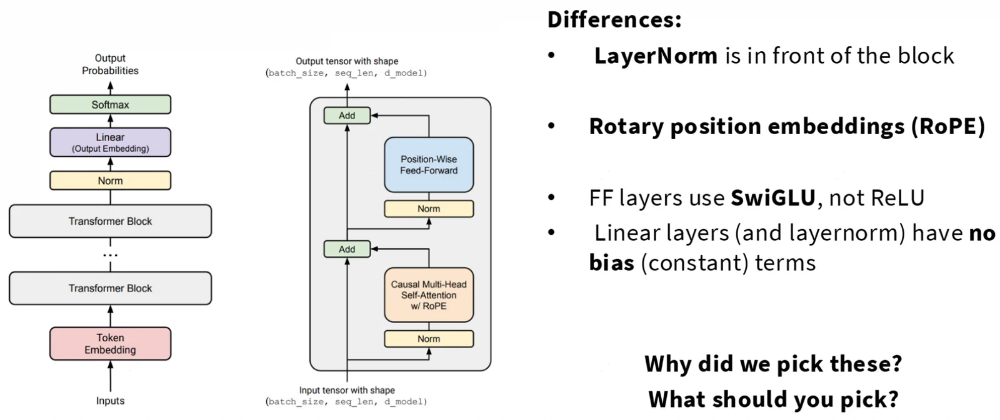
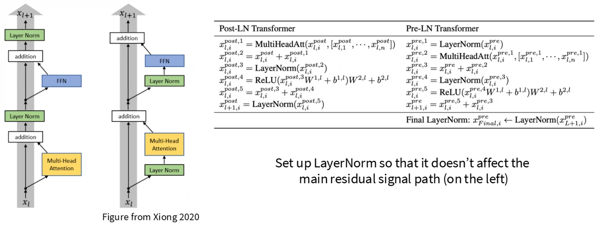
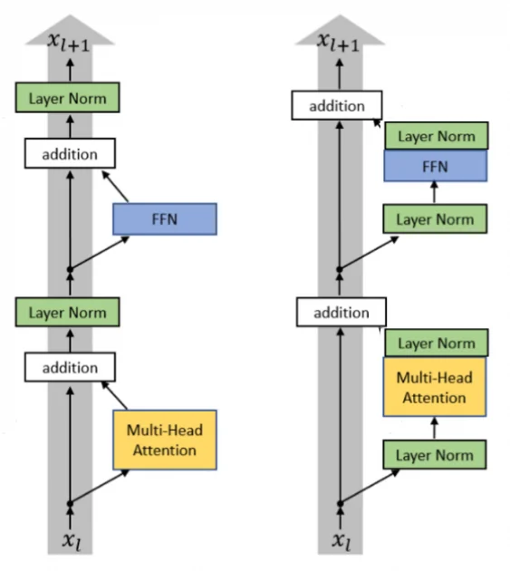
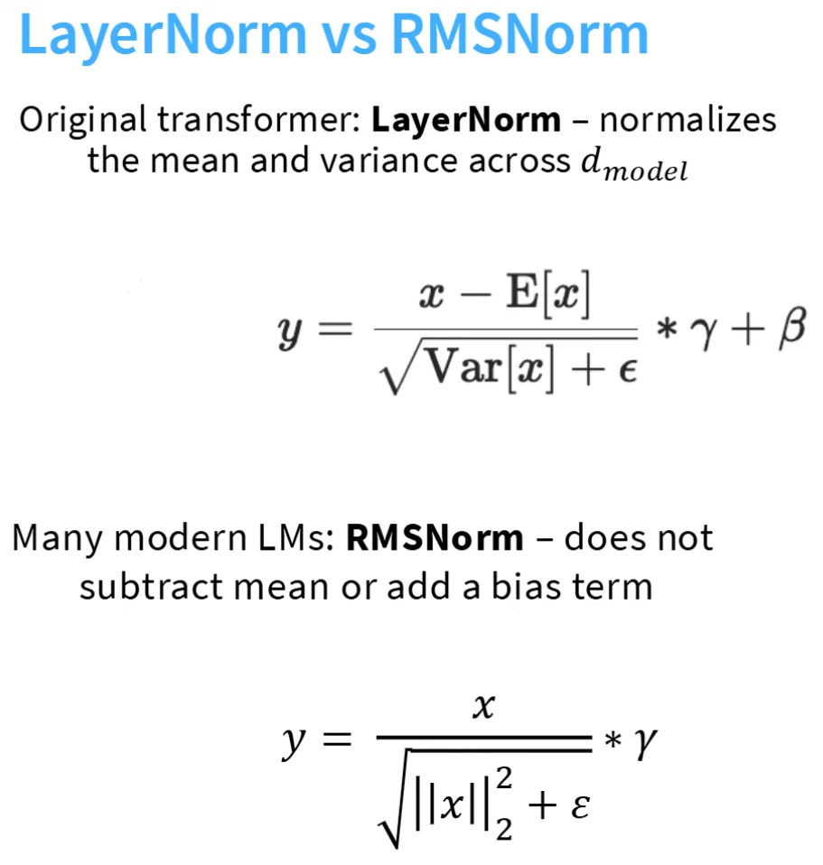
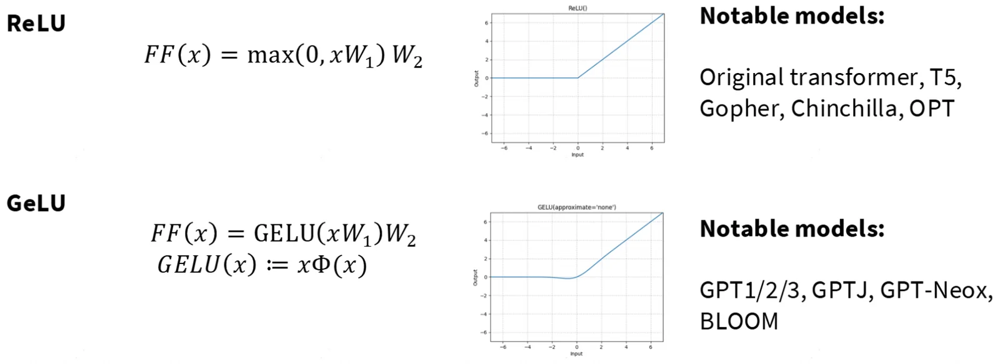
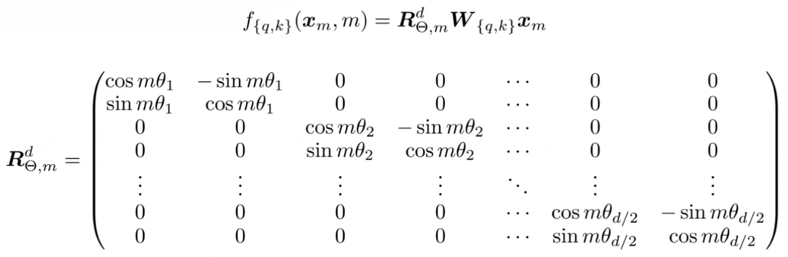
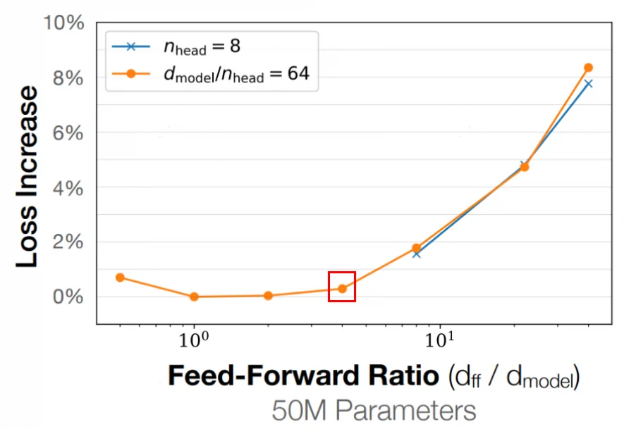
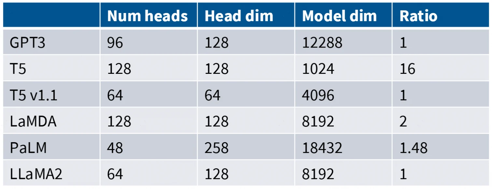
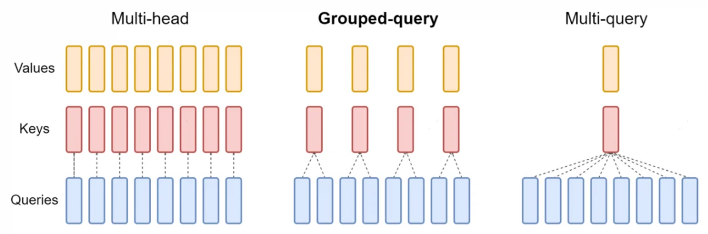

> 本文是 [Stanford CS336（Spring 2025）](https://stanford-cs336.github.io/spring2025/)的个人学习笔记，并非课程官方材料。课程截图及相关材料版权归 Stanford University 与课程作者所有。

这里主要介绍transformer架构的一些变体。

## 1. Transformer 及其变体

### 1.1 Standard Transformer

标准transformer长这样：

### 1.2 Assignment 1 Version

作业一中实现的长这样：

可以看到，这里只有decoder解码器，没有encoder，是decoder-only的。

### 1.3 Variations

一般架构发生变化的地方在：

- 归一化的位置与类型
- 激活层，FFN
- attention变种，例如MHA、MQA、MLA
- 位置编码

需要确定的超参数：

- `ff_dim`与`model_dim`的比例
- `num_heads × head_dim`是否等于`model_dim`
- 模型的宽深比
- 词表大小

下面讨论各个变种的优劣情况。

## 2. LayerNorm

### 2.1 Pre-norm vs Post-norm

现代LLM几乎都使用pre-norm（原始Transformer、BERT是post-norm），二者的区别见下图，只有layer-norm摆放的位置不同：

- **pre-norm在attention、FFN之前，并且不会摆放在residual stream上，残差不会被layer-norm影响。**

[Xiong et al., 2020](https://arxiv.org/abs/2002.04745) 对比了pre-norm和post-norm的影响，pre-norm的训练稳定性和效率是更高的。现在也有新模型将所谓的"post-norm"(其实应该叫second-norm)放在residual stream外面，不过还是没有丢弃掉pre-norm，形成一种**double-norm**：

### 2.2 LayerNorm vs RMSNorm

现在很多模型使用RMSNorm，比如DeepSeek-V3等等，而不是最初transformer内的LayerNorm：

可以看到RMSNorm的计算做了简化，这也是RMSNorm的优势：

- **计算更少**：不计算平均值
- **参数量更少**：没有bias参数项。除了RMSNorm外，现在主流LLM里面很多地方的bias项也都被去掉了，例如FFN，这有利于减轻计算、内存资源使用，并提升训练稳定性
- **工程效果更好**

这里引出一个问题是：现在大模型的主要计算都在矩阵乘上，RMSNorm这一点计算量不会有什么影响，那么RMSNorm计算量更少的优势还仍然成立吗？

- 答案是仍然成立，因为FLOPs不等于运行时间：归一化这类操作FLOPs占比很小，但数据搬运占比不小，LayerNorm到RMSNorm的切换减少的正是数据搬运，也就是改善了计算访存比。

### 2.3 总结

**LayerNorm**现在一般都是**pre-norm+RMSNorm**的形式：

- pre-norm：不干扰残差连接，训练稳定，梯度传播更加稳定，毛刺更少
- RMSNorm：
    - 与LayerNorm工作的一样好，但是使用的参数量、计算量更小
    - 相比LayerNorm去掉了bias项，在很多模块都有这种情况，例如FFN

## 3. Activation

### 3.1 ReLU（Rectified Linear Unit）

一般是这种形式：

$$
f(x) = \max(0, x)
$$

在FFN中，是这样的，也就是放在两层linear中间：

$$
\operatorname{FF}(x) = \max(0, xW_1)W_2
$$

### 3.2 GELU（Gaussian Error Linear Unit）

一般是这种形式：

$$
f(x) = x\Phi(x) = x \cdot \frac{1}{2} \left[1 + \operatorname{erf}\left(\frac{x}{\sqrt{2}}\right)\right]
$$

- 其中$\Phi(x)$是标准正态分布的累积分布函数(CDF)
- $\operatorname{erf}(\cdot)$是误差函数(error function)：

$$
\begin{aligned}
\text{PDF:} \; \phi(x) &= \frac{1}{\sqrt{2\pi}} e^{-x^2/2} \\
\text{CDF:} \; \Phi(x) &= \int_{-\infty}^x \phi(t) \, \mathrm{d}t \\
\operatorname{erf}(x) &= \frac{2}{\sqrt{\pi}} \int_0^x e^{-t^2} \, \mathrm{d}t
\end{aligned}
$$

$\operatorname{erf}$是超越函数，早期实现（如GPT-2）用$\tanh$做近似；现在的框架默认直接计算精确的$\operatorname{erf}$：

$$
\begin{aligned}
\operatorname{FF}(x) &= \operatorname{GELU}(xW_1)W_2 \\
\operatorname{GELU}(x) &\approx \frac{1}{2} x \left[1 + \tanh\left(\sqrt{\frac{2}{\pi}}\left(x+0.044715x^3\right)\right)\right]
\end{aligned}
$$

- GELU可以理解为：对输入$x$，以概率$\Phi(x)$保留原值，否则置零，然后取期望。这种“软门控”使其在保持非线性的同时比ReLU更平滑。

### 3.3 Gated Activations（*GLU）

就是加了一个门控，ReLU → ReGLU：

$$
\operatorname{FF}_{\text{ReGLU}}(x) = (\max(0, xW_1) \odot (xV)) W_2
$$

门控因子就是$xV$，同理也有GeGLU：

$$
\operatorname{FF}_{\text{GeGLU}}(x) = (\operatorname{GELU}(xW_1) \odot (xV)) W_2
$$

SwiGLU：

$$
\begin{aligned}
\operatorname{FF}_{\text{SwiGLU}}(x) &= (\operatorname{Swish}(xW_1) \odot (xV)) W_2 \\
\operatorname{Swish}(x) &= x \cdot \operatorname{sigmoid}(x) = \frac{x}{1+e^{-x}}
\end{aligned}
$$

### 3.4 总结

- 激活函数有很多变种，一般用的最多的是**ReLU**、**GELU**、**\*GLU**(gated门控版本)
- 激活函数中的gate(**\*GLU**)不是必需品，但是大多情况下都有帮助

## 4. Parallel Layers

之前都是先做attention，再做MLP（串行），很少有模型并行着做：

$$
\begin{aligned}
h &= x + \operatorname{Attention}(\operatorname{RMSNorm}(x)) \\
y &= h + \operatorname{MLP}(\operatorname{RMSNorm}(h))
\end{aligned}
$$

并行版本的长这样：

$$
y = x + \operatorname{MLP}(\operatorname{RMSNorm}(x)) + \operatorname{Attention}(\operatorname{RMSNorm}(x))
$$

并行版本的收益在于：

- 可以共享$\operatorname{RMSNorm}(x)$
- attention、MLP的矩阵乘可以做算子融合

## 5. Position Embeddings

### 5.1 Sine Embeddings

顾名思义就是用正弦函数来做位置编码，原始transformer里面就是这样做的：

$$
\begin{aligned}
\operatorname{Embed}(x, pos) &= x + PE_{pos} \\
PE_{(pos,2i)} &= \sin\left(\frac{pos}{10000^{2i/d_{\text{model}}}}\right) \\
PE_{(pos,2i+1)} &= \cos\left(\frac{pos}{10000^{2i/d_{\text{model}}}}\right)
\end{aligned}
$$

- `pos`：token在序列中的绝对位置索引，取值$0, 1, \dots, L-1$
- `i`：频率索引，取值$0, 1, \dots, d_{\text{model}}/2-1$；第$2i$维用sin，第$2i+1$维用cos
- `d_model`：模型的embedding维度

每一对维度对应一个频率：$i$小的维度频率高，区分相邻位置；$i$大的维度频率低，区分远距离位置。常数10000决定了最长的波长（$2\pi \cdot 10000$）。

特点：

- 没有可训练参数
- 由三角恒等式，$PE_{pos+k}$可以表示为$PE_{pos}$的线性变换，隐式包含了相对位置信息
- 编码是固定的，且位置与语义只是简单相加

### 5.2 Absolute Embeddings

可学习的绝对位置编码，通过Embedding层训练：

$$
\operatorname{Embed}(x, pos) = x + PE_{pos}, \qquad PE \in \mathbb{R}^{L_{\max} \times d}, \quad PE_{pos} \in \mathbb{R}^{d}
$$

- 实现简单，可以随任务学习
- 长度受$L_{\max}$限制，无法外推，也没有相对位置的归纳偏置
- 需要额外的$L_{\max} \times d$个参数

### 5.3 Relative Embeddings

$$
e_{ij} = \frac{x_iW^Q(x_jW^K+a_{ij}^{K})^T}{\sqrt{d_z}}
$$

- $x_iW^Q$、$x_jW^K$：位置$i$的query向量和位置$j$的key向量
- $a_{ij}^{K}$：相对位置编码向量，仅依赖相对距离$i-j$
- $d_z$：注意力头的维度
- $e_{ij}$：位置$i$对位置$j$的注意力分数

也就是在attention计算时的K后边加一个相对的位置编码，而不是直接与$x$相加了。这样相同相对距离的一对token在序列的任何位置都得到相同的位置编码（平移不变）。

### 5.4 RoPE（Rotary Position Embeddings）

#### 5.4.1 核心思想

通过**旋转向量**将绝对位置信息编码到embedding中，使得注意力计算天然具备相对位置感知能力：

$$
\langle f(x_m, m),\ f(x_n, n) \rangle = g(x_m, x_n, m-n)
$$

即：两个旋转后向量的内积**仅依赖于相对距离** $m-n$，而非绝对位置 $m, n$。

#### 5.4.2 数学形式

对每对相邻维度 $(x^{(2i)}, x^{(2i+1)})$ 应用2D旋转：

$$
\begin{bmatrix}
x^{(2i)} \\ x^{(2i+1)}
\end{bmatrix}
\longmapsto
\begin{bmatrix}
\cos m\theta_i & -\sin m\theta_i \\
\sin m\theta_i & \cos m\theta_i
\end{bmatrix}
\begin{bmatrix}
x^{(2i)} \\ x^{(2i+1)}
\end{bmatrix}
$$

其中 $\theta_i = 10000^{-2i/d}$，$m$ 为位置索引。把每对维度看成一个复数$x^{(2i)}+\mathrm{i}x^{(2i+1)}$，旋转可以写成紧凑形式：

$$
f(x, m)_i = x_i \, e^{\mathrm{i} m \theta_i}
$$

高维形式：

#### 5.4.3 为什么能编码相对位置

对每一对维度，用复数形式计算内积（$\bar{x}$表示共轭）：

$$
\langle f(x_m, m),\ f(x_n, n) \rangle_i
= \operatorname{Re}\left[x_{m,i}\, \bar{x}_{n,i}\, e^{\mathrm{i}(m-n)\theta_i}\right]
$$

结果只通过$m-n$依赖位置，模型无需显式计算$m-n$。

特点：

- 只对Q、K做旋转，不改变注意力的其余结构，也不引入可训练参数
- 是目前主流LLM采用的位置编码
- 与正弦编码使用同一组频率，区别在于正弦编码是**加到**embedding上，RoPE是对Q、K做**旋转**
- 旋转对任意位置都有定义，但推理长度明显超过训练长度时，效果仍然会下降

## 6. Hyperparameters（超参数）

### 6.1 FFN dim

下图中，$d_{ff}/d_{model}=4$这个点基本上就是loss开始增大的拐点了。

所以一般设置$d_{ff} = 4 d_{model}$，也有例外：[GLU](#33-gated-activationsglu)一般设置为$d_{ff} = \frac{8}{3} d_{model}$，因为多了一个门控矩阵$V$，这样参数量保持一致。

### 6.2 num_heads, head_dim and model_dim

事实上，这三个参数的关系并不一定是 $\text{num\_heads} \times \text{head\_dim} = \text{model\_dim}$，这里定义：

$$
\text{ratio} = \frac{\text{num\_heads} \times \text{head\_dim}}{\text{model\_dim}}
$$

部分模型的ratio并不是1，但大部分模型还是保持1：

### 6.3 Aspect Ratio

定义为 $d_{model}/n_{layer}$，也就是模型feature维度除以模型层数，即模型“宽度”与“深度”的比值：

- aspect ratio越大，模型越胖，深度不够，表达能力可能变弱
- aspect ratio越小，模型越瘦，深度太深，层间只能串行计算，并行能力不足，延时增加

一般主流模型都设置aspect ratio在100~200之间。

### 6.4 Vocab Size

一般设置30k~250k：单语模型约30k~50k，多语/生产模型约100k~250k。

### 6.5 Dropout and Weight Decay

二者在传统意义上都是正则化技术。

#### 6.5.1 Dropout

训练时随机把一部分激活置零，并对剩下的部分做缩放以保持期望不变（inverted dropout）：

$$
y = \frac{1}{1-p} \cdot (x \odot m), \quad m \sim \text{Bernoulli}(1-p)
$$

- $p$：dropout率（如0.1表示屏蔽10%的激活）
- $m$：随机掩码向量
- $\frac{1}{1-p}$：**训练时**的缩放补偿；推理时不做屏蔽，也不做缩放

较早的模型常用0.1的dropout；较新的LLM预训练中多数已不再使用dropout，因为数据量远大于模型容量，基本只过一遍数据，过拟合风险低。

#### 6.5.2 Weight Decay（权重衰减）

对SGD来说，weight decay等价于在损失上加L2正则项：

$$
\mathcal{L}_{\text{total}} = \mathcal{L}_{\text{task}} + \frac{\lambda}{2} \|\theta\|^2_2
\quad\Longrightarrow\quad
\theta \leftarrow \theta - \eta \nabla\mathcal{L}_{\text{task}} - \eta\lambda\theta
$$

对Adam这类自适应优化器，L2正则项的梯度会被二阶矩估计一起缩放，二者不再等价。AdamW把衰减从梯度中解耦出来，梯度仍在当前权重上计算：

$$
\theta \leftarrow \theta - \eta \left( \frac{\hat{m}}{\sqrt{\hat{v}}+\epsilon} + \lambda\theta \right)
$$

- $\lambda$的典型值为0.01~0.1，bias和norm的参数通常不做衰减
- 课上的一个要点：LLM预训练几乎不存在过拟合问题，weight decay在这里的作用并不是防止过拟合，而是与学习率调度（例如cosine衰减）相互作用，最终得到的是更低的**训练**loss

## 7. 训练稳定性

可以看训练的loss和梯度L2范数来确定训练是否是稳定的，稳定的训练上述两个指标应该是平滑、毛刺较少的。

softmax涉及指数运算，是数值上最容易出问题的地方，模型里有两处：

- 输出层的softmax：可以加z-loss，把归一化因子$\log Z$约束在0附近
- attention里的softmax：可以对Q、K先做归一化再做内积（QK-norm），或者对logits做soft-capping（用$\tanh$限制幅值）

## 8. Attention Variants

### 8.1 GQA/MQA

- 核心idea：减少K、V的头数来降成本（query的头数不变），主要是因为推理decode时算术强度低，减少K、V头的个数可以降低KV cache的访存量

MQA只保留K、V的一个头，这样KV cache的访存成本就会降低$h$倍。GQA则是对query头进行分组，每一组共享一份K、V。

### 8.2 Sparse/Sliding Attention

- 核心idea：访问整段上下文成本较高，只稀疏跳跃着访问降低成本，或者只访问窗口内部的KV

> 现在很多模型使用interleave的方案，也就是有的层是全注意力，有的层是稀疏注意力，交织排列

## 9. 总结

主流模型很多地方存在变种，包括但不限于：

- 归一化
- 激活层
- 位置编码
- attention

主流的模型通常采用：

- pre-norm + RMSNorm，去掉bias
- SwiGLU，$d_{ff} = \frac{8}{3} d_{model}$（非门控激活时为$4 d_{model}$）
- RoPE
- $\text{num\_heads} \times \text{head\_dim} = \text{model\_dim}$，aspect ratio在100~200之间
- 推理成本敏感时使用GQA
- AdamW + weight decay，预训练基本不用dropout
