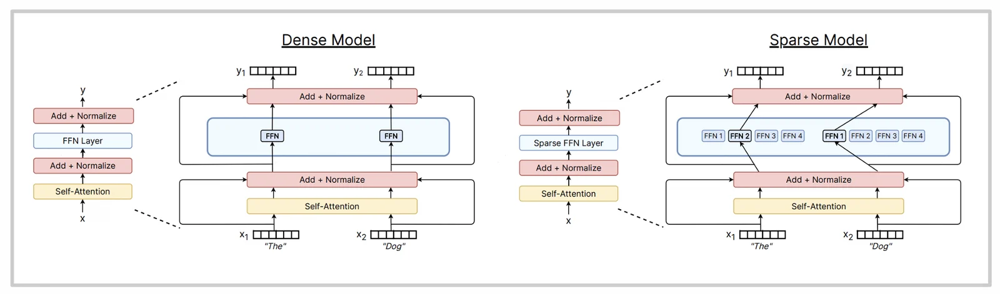
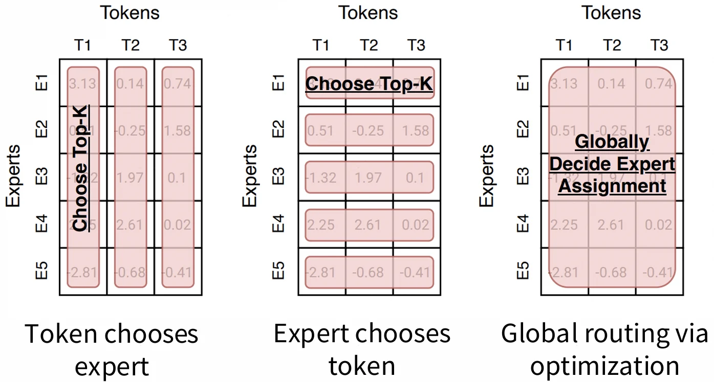
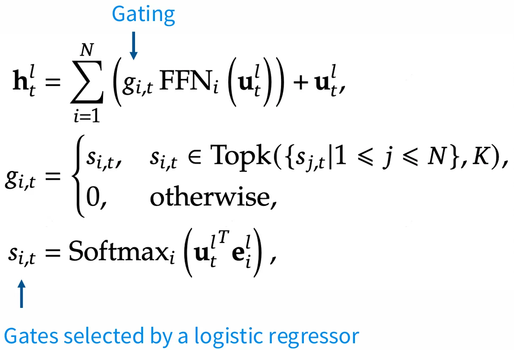
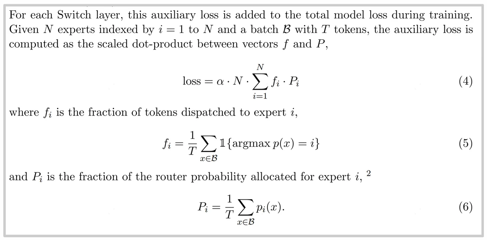
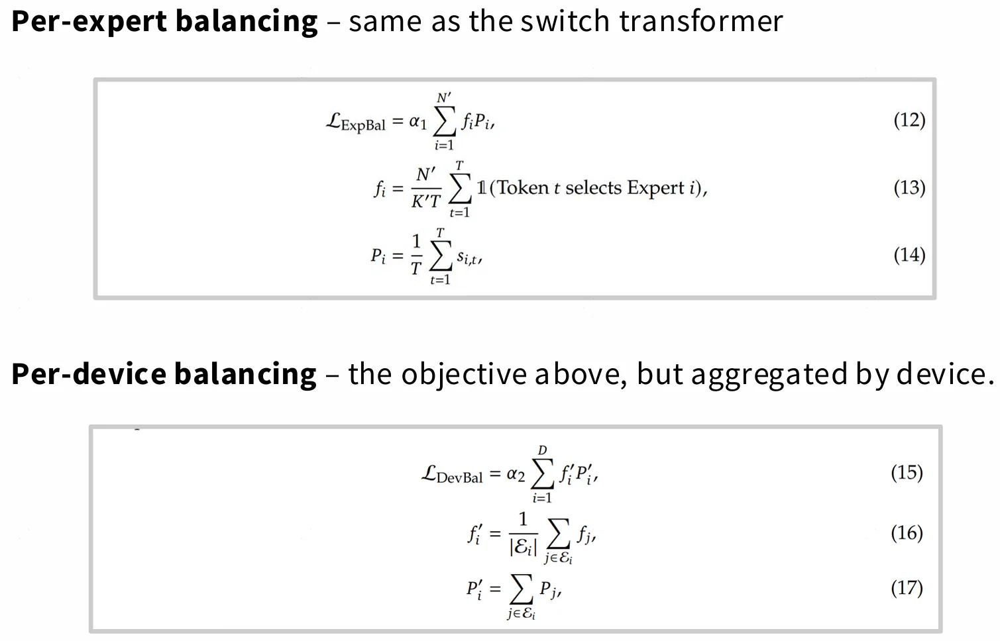
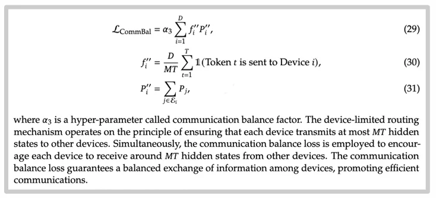
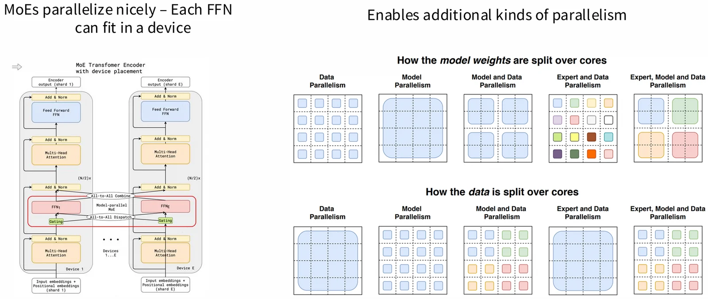
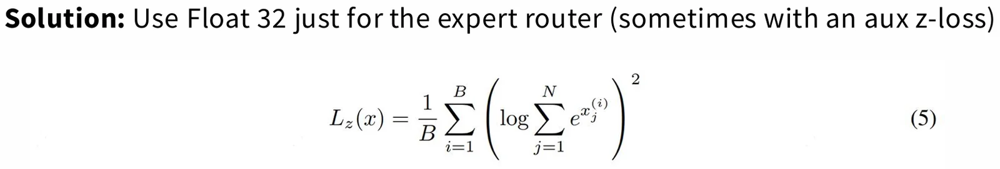
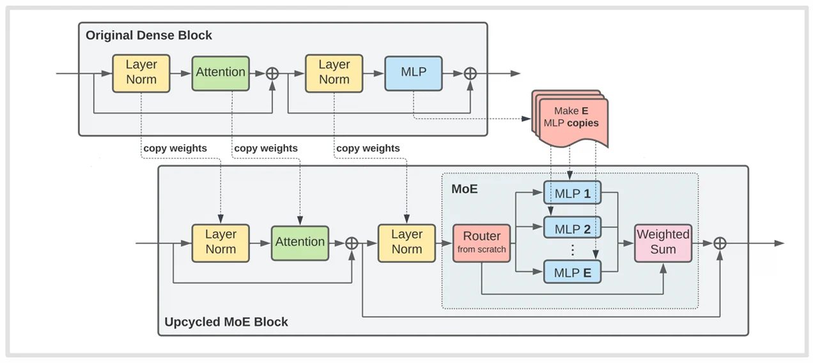

> 本文是 [Stanford CS336（Spring 2025）](https://stanford-cs336.github.io/spring2025/)的个人学习笔记，并非课程官方材料。课程截图及相关材料版权归 Stanford University 与课程作者所有。

## 1. MoE 简介（Mixtures of Experts）

下面这张图比较直观，列出了 MoE 跟正常 MLP 的主要区别：

## 2. MoE 特点

MoE 的好处主要是：

- 训起来快
- 相同FLOPs下，比稠密模型表现更好
- 可专家并行

缺点是：

- 训起来相对稠密模型会不稳定
- infra更加复杂

一般来说，MoE 结构主要应用在 MLP 层，而不是 attention 层。

## 3. MoE 模块及变种

### 3.1 Routing Function（路由函数）

其实 MoE 可以有如下几种路由选择，但几乎所有主流模型里，都是「token 选择 Top-K experts」这一类方案：

#### 3.1.1 Variants

- **Hash routing**：通过将输入哈希到对应的专家，而不是对专家进行打分后再选择 Top-K，一般作为对比的基线使用。
- **RL to learn routes**：用强化学习来学习路由，现在已经不常见了。
- **BASE routing**：将路由看作一个线性分配问题。

#### 3.1.2 Top-K Routing

比较经典的是下面这种 Top-K 路由方法，DeepSeek-V3 也是采用的这种办法：

核心 idea：router 是一个可学习的线性投影，FFN 的输入 $x$ 与每个专家对应的向量 $e_i$ 做内积后过 softmax 得到打分，从而选择 Top-K 分数最高的专家进行路由，最后再加上共享专家的部分。

### 3.2 Expert Sizes（专家大小）

DeepSeekMoE 的消融实验表明：把专家切得更细（单个专家更小、数量更多，fine-grained experts），再加上少量始终激活的共享专家（shared experts），对模型性能有帮助。共享专家的收益并不是普适的结论，OLMoE 的实验中共享专家就没有带来提升。

### 3.3 Training Objectives（训练目标）

训练的核心困难在于 Top-K 选择是离散、不可导的，router 没法直接用梯度训练。课上列了三类办法：

- 用强化学习来优化路由策略
- 加随机扰动（stochastic perturbation），让路由带有探索
- 启发式的负载均衡损失（主流做法）

如果不加约束，稀疏路由还会出现**专家负载不均衡（expert imbalance）**：某些专家被频繁使用，而其他专家几乎不用，造成参数浪费和训练不稳定。

#### 3.3.1 Heuristic Balancing Losses（启发式负载均衡损失）

PPT里给了Switch Transformer的公式：

看公式可能比较复杂，但是实际上很简单，就是在原本的训练loss上新增了一个**balance loss**，用它来衡量MoE网络里的负载均衡情况，其中：

- **$f_i$:** 代表当前expert处理了多少比例的token，很明显，绝对均衡下的期望是$1/N$
- **$P_i$:** 代表门控网络对当前expert的偏好，绝对均衡下的期望是$1/N$

绝对均衡时$f\_i=P\_i=1/N$，所以$N \sum\_{i=1}^N f\_i P\_i = 1$，这也是这一项的最小值；负载越集中，这一项越大。DeepSeek 把这一项叫$\mathcal{L}\_{\text{ExpBal}}$，意为expert维度的负载均衡损失项。DeepSeekMoE（V1）在此基础上增加了device维度的$\mathcal{L}\_{\text{DevBal}}$，DeepSeek-V2又增加了communication维度的$\mathcal{L}\_{\text{CommBal}}$；DeepSeek-V3则不再依赖辅助损失，改为给每个专家的路由打分加一个动态调整的bias来做均衡：

#### 3.3.2 并行训练

这里给了一张比较经典的MoE并行方法图：

### 3.4 MoE 中常见问题

- **随机性**：如果 infra 实现不够好，例如限定死每个 expert 的容量，超出的 token 直接丢弃掉，可能会引起吐字异常。假如有多个 batch 同时进来，那么有可能 batch 之间会相互冲刷，也就是一个回答会被另一个回答影响。
- **稳定性**：MoE 中的 Top-K 选择会带来稳定性问题，所以一般用 float32 来做 expert router，但也不能保证 float32 就完全没问题。可以通过引入 Z-loss 来一定程度上规避这个问题：

- **SFT 过拟合**：MoE 稀疏模型在 SFT 阶段似乎更容易过拟合，解决办法是使用更多、更加多样化的微调数据。

### 3.5 Upcycling

上述问题也引出了其他训练方法（upcycling）：假设现在已经有一个预训练好的稠密模型，那么可以把它的 MLP 复制多份作为各个专家，来初始化 MoE 模型：

## 4. DeepSeek V1~V3

课程最后以 DeepSeek V1~V3 为例回顾了上面的设计：fine-grained + shared experts、Top-K 路由，以及从辅助损失到 bias 均衡的演进（见 3.3.1）。DeepSeek-V2/V3 中 MLA 的推导这里不再详述。
