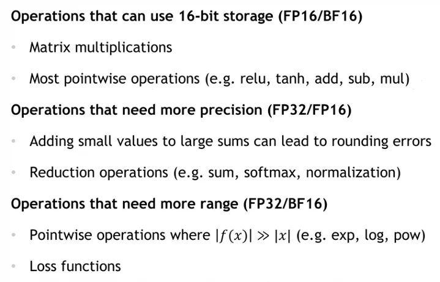
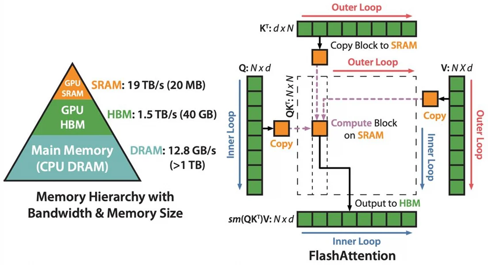
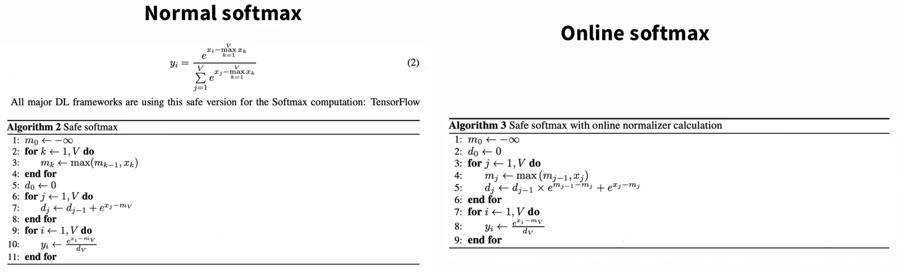
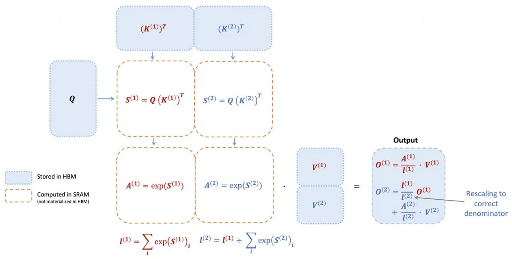

> 本文是 [Stanford CS336（Spring 2025）](https://stanford-cs336.github.io/spring2025/)的个人学习笔记，并非课程官方材料。课程截图及相关材料版权归 Stanford University 与课程作者所有。

本节课开头的 GPU 硬件简介这里没有记录，直接从性能优化手段开始。

## 1. Performance

### 1.1 Low Precision Computation

低精计算带来的收益主要是两个方面：

- 降低计算量
- 降低访存量

下面列举了几个ops对应的精度需求：



### 1.2 Operator Fusion

eager模式下每个算子都是一次独立的kernel调用，中间结果要写回显存再读出来；借助`torch.compile`可以把相邻的逐元素算子融合成一个kernel，例如下面两次`cos`在编译后只需要读写一次显存：

```python
@torch.compile
def f(x):
    x1 = x.cos()
    x2 = x1.cos()
    return x2
```

这样做的好处是，可以减少访存量，不用反复读取，以及减少调度层面的开销，让算子变得更大，CPU调度时间也可以被更好的掩盖掉。

### 1.3 Recomputation

为了快速计算反向传播时的梯度，我们存了前向计算的中间激活值，但实际上这些值的读写也很耗时间，不如直接重新去计算。

### 1.4 Memory Coalescing and DRAM

这里主要介绍的是合并内存读写（coalescing）：DRAM是按burst读取的，一次读会把相邻的一段地址一起带出来。同一个warp内的线程如果访问的是相邻地址，这些访问就可以被合并成一次burst完成。所以GPU上要把同一个warp内各线程访问的内存尽量排布在一起，以触发访存合并，提升带宽利用率。

### 1.5 Tiling

gemm里常用的分块计算方法，主要是可以把数据放在shared memory里，增加数据的利用效率，降低访存量。影响tiling size的因素主要是：

- 内存访问合并：尽量让内存对齐（aligned），有时矩阵的shape不支持百分百对齐，那么就可以去做padding
- 共享内存大小
- 矩阵维度的可分性

### 1.6 总结

优化方式主要是以下三点：

1. 降低访存量
    - 内存合并
    - 算子融合
2. 善用shared memory
    - tiling矩阵分块
3. 访存与计算or精度之间的trade-off
    - 量化
    - 重计算

## 2. FlashAttention

核心idea：标准实现会把$N \times N$的attention矩阵完整写到显存（HBM）里，访存量是$O(N^2)$。FlashAttention把Q、K、V分块，每次只把一小块搬进片上的SRAM，在SRAM里算完这一块的matmul、softmax和加权求和，只把最终输出写回HBM，始终不落地完整的attention矩阵；反向传播时也不保存attention矩阵，而是重计算。它用到的正是上一节的tiling、算子融合和重计算。

### 2.1 公式回顾

$$
\operatorname{Attention}(X) = \operatorname{softmax}\left(\frac{XQ(XK)^T}{\sqrt{d_k}}\right) XV
$$

### 2.2 Matmul

就是正常的矩阵分块方法：



### 2.3 Softmax

softmax为了计算安全，做了变式，上下都除以了$e^{x_m}$，限制了数值不会太大而导致溢出。

$$
\begin{aligned}
    x_m &= \max(X) \\
    y_i &= \frac{e^{x_i-x_m}}{\sum_j e^{x_j-x_m}}
\end{aligned}
$$

分块之后的困难在于softmax需要整行的归一化因子。online softmax（Milakov & Gimelshein, 2018；FlashAttention第一版就已使用）在逐块扫描时维护running max和running sum，每来一块就对已有结果做一次修正：



从伪代码上看，online softmax是把normal softmax的前两个循环合并为了一个循环；更重要的是它不需要先看到整行数据，因此可以和分块计算配合，逐块得到正确的归一化结果。

### 2.4 总体

总的来说就是这样：


