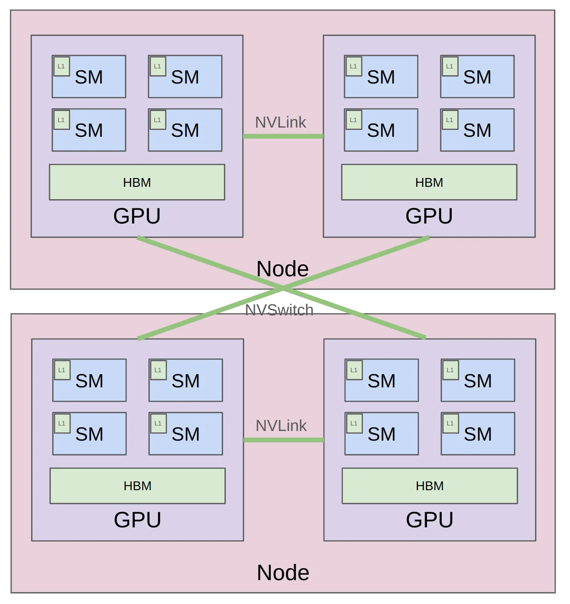

> 本文是 [Stanford CS336（Spring 2025）](https://stanford-cs336.github.io/spring2025/)的个人学习笔记，并非课程官方材料。课程截图及相关材料版权归 Stanford University 与课程作者所有。

## 1. 介绍

这里首先给了张网络拓扑图，通信方式一般是：

- 单节点，单GPU：L1 cache / shared memory / HBM
- 单节点，多GPU：GPU之间通过NVLink / NVSwitch直连，不需要经过CPU和PCIe
- 多节点，多GPU：节点之间走IB / RoCE等高速网络（见[上一讲](/courses/cs336/07-parallelism/)），同样不经过CPU，也不走普通Ethernet

## 2. 分布式计算

分别介绍了集合通信术语、torch.distributed，以及DP/TP/PP的简单实现。

### 2.1 集合通信术语

**Broadcast**、**Scatter**、**Gather**、**Reduce**、**All-gather**、**Reduce-scatter**、**All-reduce = reduce-scatter + all-gather**等等，不再详细展开，参考[课件](https://stanford-cs336.github.io/spring2025-lectures/?trace=var%2Ftraces%2Flecture_08.json&step=25)

### 2.2 torch.distributed

通信后端：gloo (CPU), nccl (GPU)。gloo默认走TCP，比较慢，GPU训练用nccl。

### 2.3 DP / TP / PP

接下来以MLP为例介绍了一下DP/TP/PP的简单代码，比较简单，可以直接看[课件](https://stanford-cs336.github.io/spring2025-lectures/?trace=var%2Ftraces%2Flecture_08.json&step=174)
