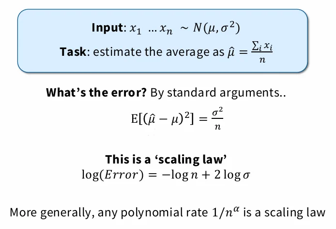
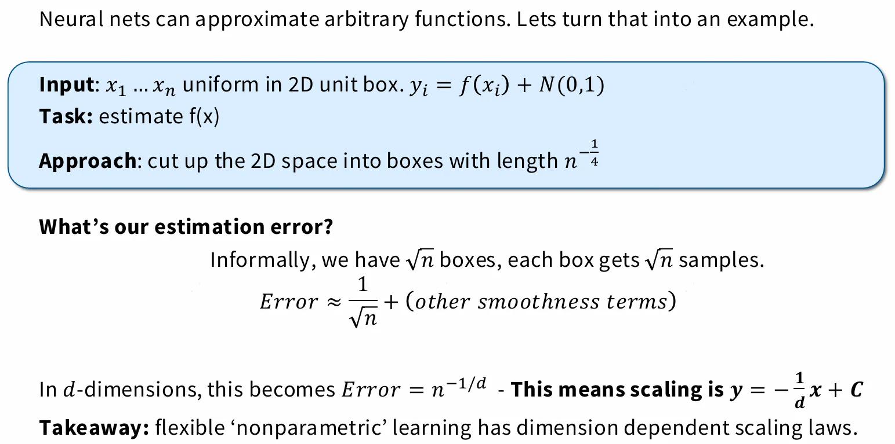
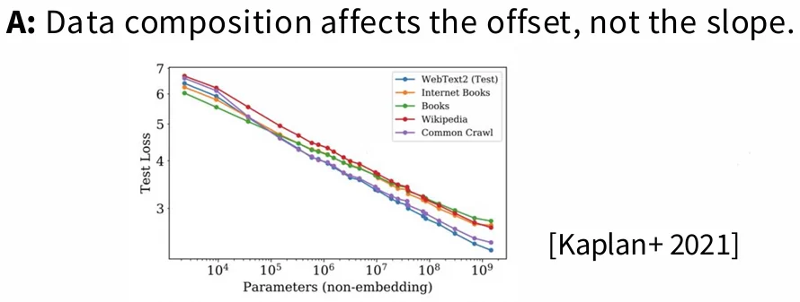
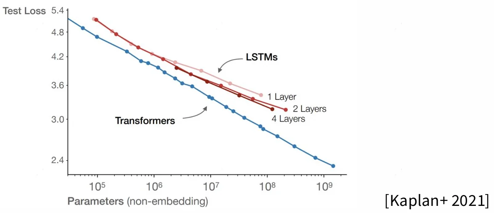
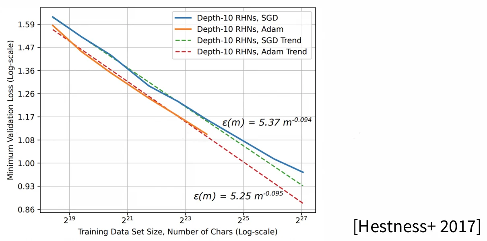
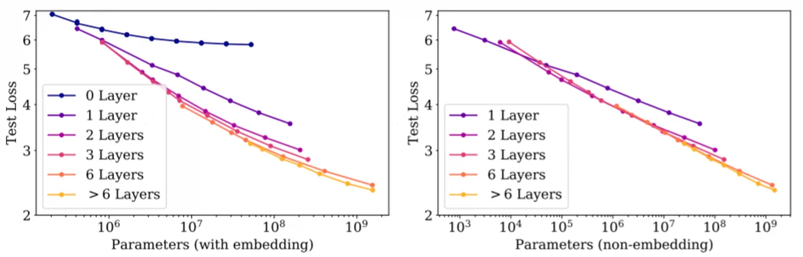
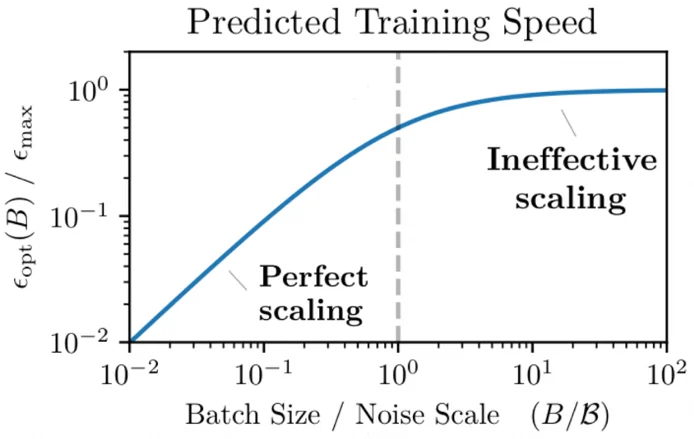

> 本文是 [Stanford CS336（Spring 2025）](https://stanford-cs336.github.io/spring2025/)的个人学习笔记，并非课程官方材料。课程截图及相关材料版权归 Stanford University 与课程作者所有。

## 1. Data vs Performance

- 数据集越大，性能越好，一定范围内在log-log坐标下近乎线性（即幂律关系）

### 1.1 两个例子

第一个例子：

这里可以推导：

1. **样本均值的期望**（无偏性）：

   $$
   \mathbb{E}[\bar{X}] = \mathbb{E}\left[ \frac{1}{n} \sum_{i=1}^{n} X_i \right] = \frac{1}{n} \sum_{i=1}^{n} \mathbb{E}[X_i] = \frac{1}{n} \cdot n \mu = \mu
   $$

2. **样本均值的方差**（利用独立性）：

   $$
   \operatorname{Var}(\bar{X}) = \operatorname{Var}\left( \frac{1}{n} \sum_{i=1}^{n} X_i \right) = \frac{1}{n^2} \sum_{i=1}^{n} \operatorname{Var}(X_i) = \frac{1}{n^2} \cdot n \sigma^2 = \frac{\sigma^2}{n}
   $$

3. **均方误差（MSE）分解**：

   $$
   \mathbb{E}\left[ (\bar{X} - \mu)^2 \right] = \operatorname{Var}(\bar{X}) + \left( \mathbb{E}[\bar{X}] - \mu \right)^2 = \frac{\sigma^2}{n} + 0 = \frac{\sigma^2}{n}
   $$

也就是误差为$\sigma^2/n$。令$y=\log(\text{error})$、$x=\log n$，得到的形式是$y = -x + C$，但实际上的scaling law到不了这么好，于是看第二个例子：

可以看到，假如把数据分为d个维度，那么最终按照上述例子估算下来的关系式就变为了$y = -\frac{1}{d}x + C$，这样斜率是随$d$变化的而不再是$-1$，更加符合`Machine translation`，`Speech`，`Language modeling`等等不同场景下的斜率情况。因此这里大胆推测：

- **data与performance的scaling law的斜率，可能与数据的内在维度(intrinsic dimensionality)有关系**
- **数据构成影响截距**

    

### 1.2 启发

- 可以利用小模型选择最优数据组合
- 决定是否重复使用数据
- 结合上述两者，平衡数据质量与重复率

## 2. Model Scaling

### 2.1 Architecture: Transformers vs LSTMs

- transformer比LSTM scaling能力更强，更易保持线性scaling law：

### 2.2 Optimizer Choice

- Adam比SGD收敛更快，scaling law曲线上截距更小：

### 2.3 Depth/Width: Number of Layers

- 模型层数增加对模型scaling有益，但层数增加到6层之后收益会变缓

### 2.4 Batch Size: Critical Batch Size

- 临界batch size：在此之前，batch size翻倍，达到同样loss所需的步数基本减半（近乎完美的scaling）；超过之后继续增大batch size收益递减。临界batch size会随着loss降低（训练推进）而变大：

### 2.5 Learning Rates: muP and Scale-aware LR Choices

- 标准参数化下，最优学习率随模型宽度变化：模型越宽，最优学习率越小，小模型上调好的学习率不能直接搬到大模型上
- μP（maximal update parametrization）的思路是让初始化的方差和每层的学习率都按宽度做缩放，使得最优学习率在不同宽度下基本保持不变，这样就可以在小模型上调参再迁移到大模型

## 3. 应用

### 3.1 训练要点

- 训练一些小模型
- 观察scaling情况，构建scaling law关系
- 选择最优超参数

### 3.2 Joint Data–Model Scaling Laws

可以根据如下公式来进行scaling law的拟合，一般比较准：

$$
\begin{aligned}
    \text{Error} &= n^{-\alpha} + m^{-\beta} + C \\
    n&\text{：data规模} \\
    m&\text{：model规模}
\end{aligned}
$$

### 3.3 如何寻找 Scaling Laws 中的最优参数

以Chinchilla论文为例，问题是：给定计算预算$C \approx 6ND$（$N$为参数量，$D$为训练token数），$N$和$D$怎么分配loss最低。论文用了三种方法，结论基本一致。

#### 3.3.1 Minimum over Runs

对每个模型规模都训练一条完整的loss曲线，然后对每一个计算量，在所有run里取loss最低的那个点，得到“该计算量下最优的$N$”。不需要对loss的函数形式做假设，但依赖实验覆盖的密度。

#### 3.3.2 IsoFLOPs

固定若干档总计算量，每一档下训练不同大小的模型（$N$越大，$D$就越小），对“loss–$N$”的散点拟合一条抛物线，取最低点作为该预算下的最优$N$，再把各档的最优点连起来外推。

#### 3.3.3 Joint Fits

用一个参数化的函数同时拟合所有实验数据：

$$
L(N, D) = E + \frac{A}{N^\alpha} + \frac{B}{D^\beta}
$$

其中$E$是不可约的loss。拟合出参数之后，在$6ND=C$的约束下对$N$求极值，就可以解析地得到最优的$N$和$D$。这种方法可以外推，但依赖函数形式的假设是否合理。

#### 3.3.4 总结

| 方法 | 是否假设函数形式 | 是否可外推 | 用途 |
| --- | --- | --- | --- |
| Minimum over runs | 否 | 否 | 直接从已有实验读出最优点 |
| IsoFLOPs | 局部（抛物线） | 有限 | 固定预算下的最优配比 |
| Joint fits | 是 | 是 | 得到解析的最优缩放关系 |

三种方法的结论都是：最优的$N$和$D$应该大致等比例增长（$N_{\text{opt}} \propto C^{0.5}$，$D_{\text{opt}} \propto C^{0.5}$），折算下来大约是每个参数对应20个token。按这个比例，此前的大模型普遍是“模型偏大、数据偏少”的。
