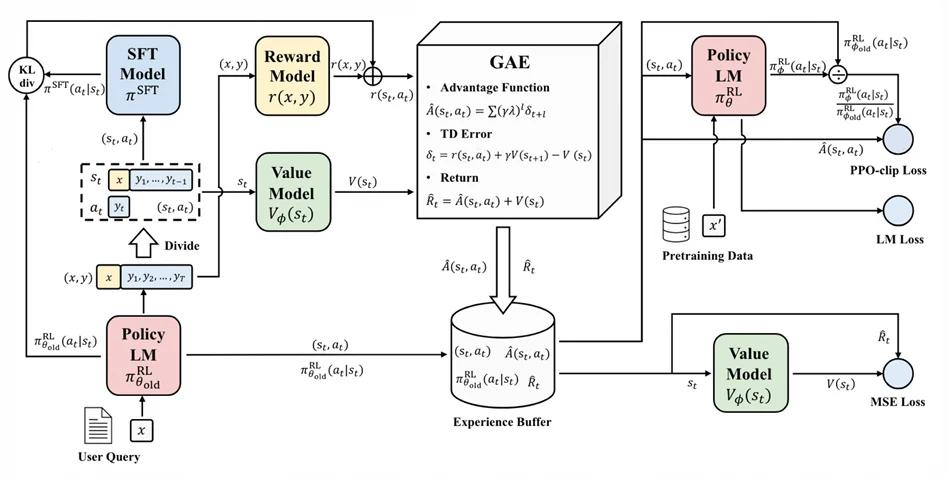

> 本文是 [Stanford CS336（Spring 2025）](https://stanford-cs336.github.io/spring2025/)的个人学习笔记，并非课程官方材料。课程截图及相关材料版权归 Stanford University 与课程作者所有。

本篇只整理了这两讲中SFT与RLHF算法（PPO、DPO、GRPO）的部分；第16讲中基于可验证奖励的RL以及具体推理模型的案例没有记录。

## 1. SFT (Supervised Fine-Tuning)

SFT（有监督微调）是在预训练之后，利用人类标注的高质量“指令-回答”对对模型进行微调，更新模型权重，使其学会遵循指令。

- 数据质量注意事项：不应在边缘或长尾知识上进行微调（即便这些知识是正确的）。如果回答里的知识是模型在预训练中没有学到的，模型学到的可能是“即使不知道也要编一个答案”，反而增加幻觉风险。
- Scaling趋势：随着SFT数据规模的扩大，SFT与预训练的界限开始模糊。一种趋势是把指令数据混入预训练的后期（mid-training / two-phase training）。

## 2. RLHF (Reinforcement Learning from Human Feedback)

SFT数据需要人工撰写，成本较高；让人比较两个回答的好坏则便宜得多。RLHF利用这种偏好数据继续优化模型。

### 2.1 Data

RLHF的核心数据来源是偏好数据，主要形式为pairwise feedback：

- 人工标注：给出多个回答，由人类标注哪个更好。主要依赖外包团队进行手工标注，质量参差不齐。
- LM生成：利用较强的模型作为judge来给出pairwise feedback，即RLAIF (RL from AI Feedback)。

### 2.2 Policy Gradient

最直接的想法是把回答$z$的奖励记为$R(z)$，最大化期望奖励：

$$
J(\theta) = \mathbb{E}_{z \sim p_{\theta}}[R(z)]
$$

其梯度为：

$$
\nabla_{\theta} J(\theta) = \mathbb{E}_{z \sim p_{\theta}}[R(z)\nabla_{\theta}\log p_\theta(z)]
$$

问题在于梯度的方差很大，直接这样训练不稳定；而且每更新一步就要用新策略重新采样。因此需要更保守的更新策略。

### 2.3 TRPO (Trust Region Policy Optimization)

TRPO将策略更新建模为一个带约束的优化问题，用重要性采样复用旧策略采到的数据，并约束新旧策略不能相差太远：

$$
\max_{\theta} \; \mathbb{E}_{s \sim \rho_{\theta_{old}},\, a \sim \pi_{\theta_{old}}} \left[ \frac{\pi_{\theta}(a \mid s)}{\pi_{\theta_{old}}(a \mid s)} A_{\theta_{old}}(s, a) \right]
\qquad
\text{s.t.} \quad \bar{D}_{KL}(\pi_{\theta_{old}} \,\Vert\, \pi_{\theta}) \leq \delta
$$

- $\pi_{\theta}(a \mid s)$：策略函数，在状态$s$下采取动作$a$的概率
- $A_{\theta_{old}}(s, a)$：优势函数，衡量动作$a$相对于平均水平的优劣
- $\pi_{\theta}(a \mid s)/\pi_{\theta_{old}}(a \mid s)$：重要性采样权重，修正用旧策略采样带来的偏差
- $\bar{D}_{KL}$：新旧策略的平均KL散度

缺点是求解带约束问题需要二阶信息（Fisher信息矩阵），计算量大，工程实现困难。

### 2.4 PPO (Proximal Policy Optimization)

PPO是TRPO的简化版，把约束换成目标函数里的截断（PPO-Clip）：

$$
L^{CLIP}(\theta) = \mathbb{E}_t \left[ \min \left( r_t(\theta) A_t,\; \operatorname{clip}(r_t(\theta), 1-\epsilon, 1+\epsilon) A_t \right) \right]
$$

- $r_t(\theta) = \pi_{\theta}(a_t \mid s_t)/\pi_{\theta_{old}}(a_t \mid s_t)$：概率比率，$r_t=1$表示新旧策略一致
- $A_t$：当前时刻的优势估计值
- $\epsilon$：截断参数（通常为0.1或0.2）

截断的作用：

- 若$A_t > 0$，目标会推动$r_t$变大，但超过$1+\epsilon$之后这一项不再增长，也就没有继续增大的动力
- 若$A_t < 0$，目标会推动$r_t$变小，但低于$1-\epsilon$之后同样不再有收益
- 取$\min$保证了截断后的目标是未截断目标的一个下界（悲观估计）

主要流程：

主要缺点：

- 实现复杂，需要先训练奖励模型，还要训练价值网络（critic）
- 内存占用量大

### 2.5 DPO (Direct Preference Optimization)

DPO的目标是简化RLHF流程，不再显式训练奖励模型，也不需要在线采样。

带KL正则的奖励最大化问题有闭式的最优策略，反过来可以把奖励函数用最优策略表示出来：

$$
r(x,y) = \beta \log \frac{\pi^*(y \mid x)}{\pi_{ref}(y \mid x)} + \beta \log Z(x)
$$

- $x$：提示词；$y$：生成的回答
- $\pi_{ref}$：参考模型（通常是SFT之后的模型）
- $\beta$：KL惩罚系数
- $Z(x)$：只与$x$有关的配分函数

把这个关系代入Bradley-Terry偏好模型$p(y_w \succ y_l) = \sigma(r(x,y_w)-r(x,y_l))$，$Z(x)$在做差时消掉，就得到只含策略的损失函数：

$$
\mathcal{L}_{DPO}(\pi_\theta; \pi_{ref}) = -\mathbb{E}_{(x, y_w, y_l) \sim \mathcal{D}} \left[ \log \sigma \left( \beta \log \frac{\pi_\theta(y_w \mid x)}{\pi_{ref}(y_w \mid x)} - \beta \log \frac{\pi_\theta(y_l \mid x)}{\pi_{ref}(y_l \mid x)} \right) \right]
$$

- $y_w$、$y_l$：人类偏好的回答和不偏好的回答
- $\sigma$：sigmoid函数

直观含义：相对于参考模型，提高$y_w$的概率、降低$y_l$的概率，整个过程就是一次普通的有监督训练。

### 2.6 GRPO (Group Relative Policy Optimization)

GRPO针对的是PPO中价值网络难训练、显存占用大的问题，DeepSeek-R1的训练使用了这个算法。它去掉了价值网络，用**组内平均奖励**作为基线：

1. 采样：对同一个问题$q$，生成$G$个输出 $\lbrace o_1, o_2, \dots, o_G \rbrace$
2. 计算优势：

    $$
    A_i = \frac{R_i - \operatorname{mean}(R_1, \dots, R_G)}{\operatorname{std}(R_1, \dots, R_G)}
    $$

    其中$R_i$是第$i$个输出的奖励。组内均值充当了PPO中价值网络给出的基线，组内表现好于平均的输出得到正的优势，差于平均的得到负的优势。

3. 最大化带截断和KL惩罚的目标：

    $$
    J_{GRPO}(\theta) = \mathbb{E} \left[ \frac{1}{G} \sum_{i=1}^G \min\left(r_i(\theta) A_i,\; \operatorname{clip}(r_i(\theta), 1-\epsilon, 1+\epsilon) A_i\right) - \beta\, D_{KL}(\pi_\theta \,\Vert\, \pi_{ref}) \right]
    $$

与PPO的区别只在于优势$A_i$的来源：不再依赖独立的价值网络，而是对同一个问题多次采样、在组内做比较。

### 2.7 总结

| 算法 | 核心点 | 主要缺点 |
| --- | --- | --- |
| TRPO | 信任区域约束下的策略更新 | 需要二阶信息，计算和实现复杂 |
| PPO | 用截断代替约束 | 仍需奖励模型和价值网络，显存占用大 |
| DPO | 不显式训练奖励模型，直接用偏好数据做有监督训练 | 只能利用离线的成对偏好数据 |
| GRPO | 去掉价值网络，用组内平均奖励作基线 | 每个问题需要采样多个输出 |
